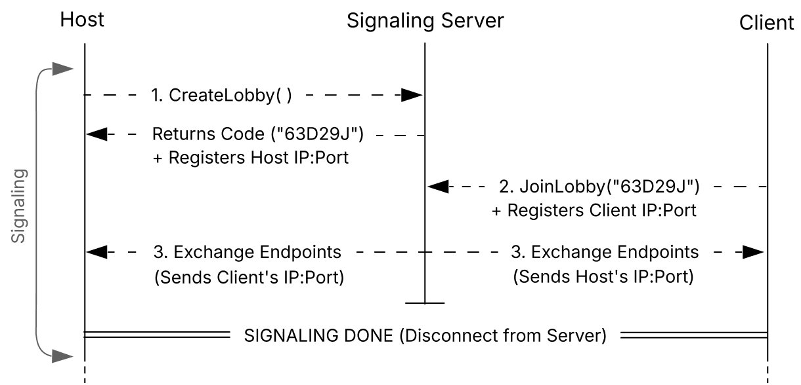

# DirectNet

> ⚠️ Status: Under active development. The matchmaking server is complete; the direct device-to-device connection logic is currently being built.

DirectNet is a C# networking library designed to connect two computers directly to each other (peer-to-peer) for fast, real-time data sharing. 

It uses a lightweight web server to introduce players, then steps out of the way so the two devices can talk directly without a middleman.

## How It Works

Connecting two computers directly over the internet can be tricky due to firewalls and home routers blocking incoming connections. DirectNet solves this in two simple phases:

1. **Signaling Phase:** Players join a room hosted on a central server. The server collects their network addresses, hands them to each player, and immediately disconnects to keep server costs and traffic minimal.
2. **Direct P2P Phase:** Both devices use those addresses to "punch through" their firewalls (NAT hole punching) and open a direct channel for sending game or app data straight to each other.

### Connection Flow

<picture>
  <source media="(prefers-color-scheme: dark)" srcset="docs/sequence-diagram-dark.png">
  <source media="(prefers-color-scheme: light)" srcset="docs/sequence-diagram-light.png">
  
</picture>

## Project Structure & Progress

* **`DirectNet.Signaling`** *(Completed)*: A lightweight ASP.NET web service that creates 6-character room codes and exchanges connection details between players.
* **`DirectNet.Core`** *(In Progress)*: The client-side library that handles direct device-to-device socket communication.
  * [x] Lobby creation and matchmaking communication
  * [ ] Native UDP socket connections
  * [ ] Automated firewall bypass (NAT hole punching)
  * [ ] Custom data packet packing and sending

## Key Highlights

* **Low Server Costs:** The central server is only used for a few seconds to introduce players. All heavy data traffic goes directly between users.
* **Safe Concurrent Lobbies:** Room codes and active sessions are managed safely in memory, preventing collisions when many players join at once.
* **Pure .NET:** Built using native .NET networking features without relying on external third-party tools or frameworks on the client.

## License

This project is licensed under the MIT License - see the [LICENSE](LICENSE) file for details.